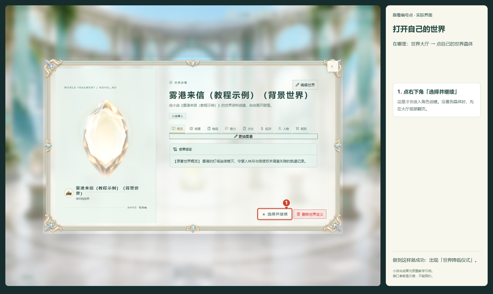
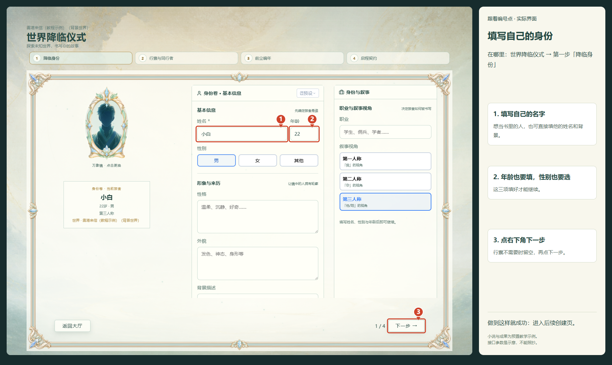
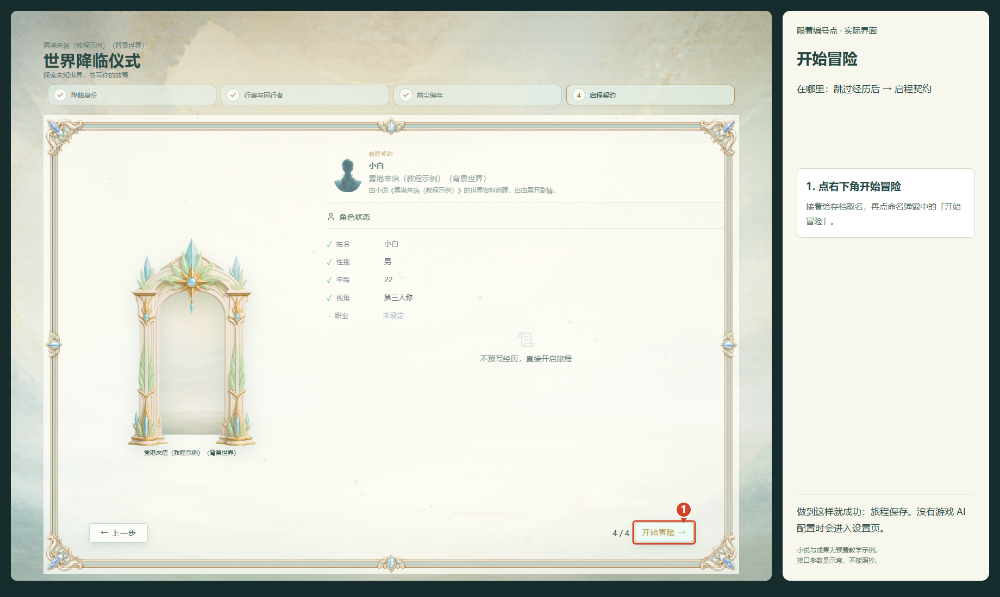
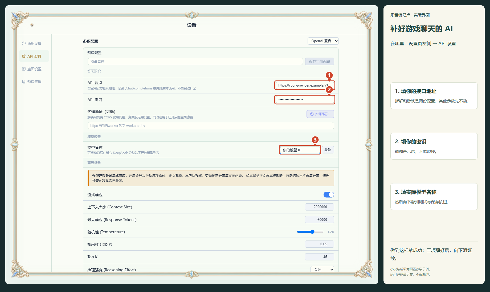
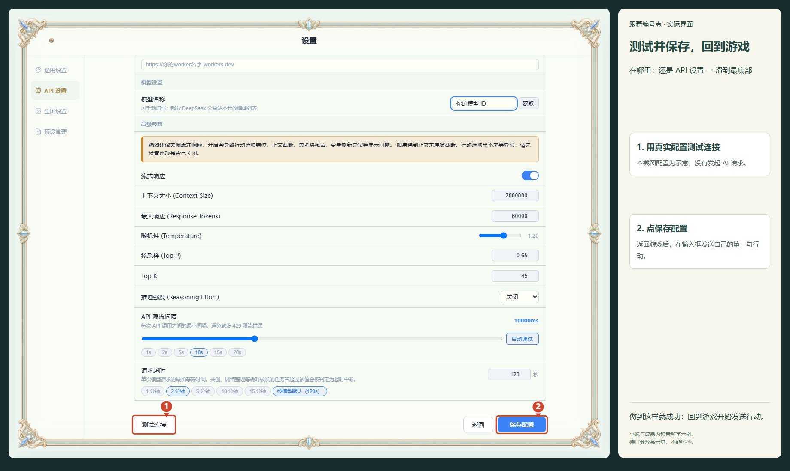

# 在小说世界里自由玩

用小说里的人物、地点和规则，开始自己的故事，不需要整理原作主线。

## 在拆解台完成四步

1. **上传小说**：上传 TXT、EPUB，检查正文，再点「下一步：选择要拆的章节」。
2. **选章拆解**：先试拆前 10 章，也可自选起止章或整本；选择「只要人物和世界设定」。保存 AI 配置，再点底部「开始拆解第…章」，所选范围一起生效。
3. **人物与设定**：看拆解效果，资料不够可「再多拆 10 章」。已有资料就能点「用当前资料创建世界」，不必拆完整本。
4. **创建世界**：填写世界名称，保持自由玩法，点底部「创建世界，回大厅游玩」。

中断时点「暂停并保存」或「保存并关闭」，回来打开「继续已有小说」中的对应小说即可继续。顶部「备份」可下载原文与成果。AI 读取会产生接口费用。

## 开局：在大厅打开刚才创建的世界

**在哪里：** 世界大厅 → 点击名字带「背景世界」的晶体

1. 创建后一般自动翻到你的世界。没看到就用大厅底部箭头翻页。
2. 点自己的世界晶体，弹出详情后点右下角「选择并继续」。

**做到这样就成功：** 进入「世界降临仪式」，第一步是「降临身份」。

## 开局：写好自己的角色身份

**在哪里：** 世界降临仪式 →「降临身份」

1. 填姓名、年龄，点选性别。想扮演书里的某个人，可以直接填他的姓名、性格和背景。
2. 点右下角「下一步」。行囊没想好可以不填，再点「下一步」。

**做到这样就成功：** 到「前尘编年」页面。

## 开局：跳过经历，正式开始冒险

**在哪里：** 「前尘编年」→「启程契约」

1. 不想写以前的经历，就点右下角「跳过经历」。
2. 下一页点右下角「开始冒险」，给存档取名，再点弹窗里的「开始冒险」。

**做到这样就成功：** 旅程已创建。已配游戏 AI 时进入游戏；没有配置时进入设置页，继续下一步。

## 开局：如果跳到设置页，补好游戏 AI

**在哪里：** 设置页左侧 →「API 设置」

1. 拆小说的 AI 和游戏聊天的 AI 要分别配置。跳到这里时，刚才的旅程已经保存。
2. 填你的接口地址、密钥和模型，往下滑测试连接，再点「保存配置」。
3. 回到游戏，在输入框发送：我环顾四周，先确认自己在哪里。已经配置游戏 AI 的玩家跳过这一步。

**做到这样就成功：** 进入游戏，可以在输入框发送自己的行动。

向下滚动后的按钮位置：

截图取自实际应用界面。小说与拆解成果是教学示例，接口参数是占位示意，不能照抄。教学验证没有发起付费 AI 请求。
