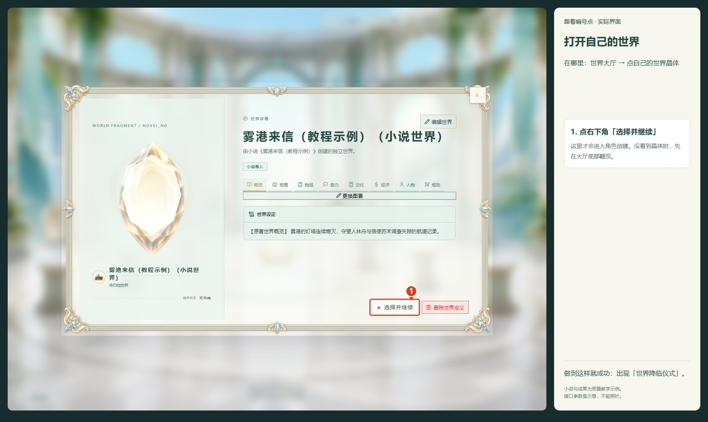
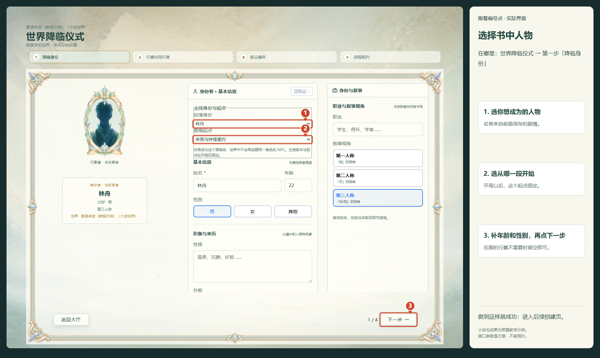
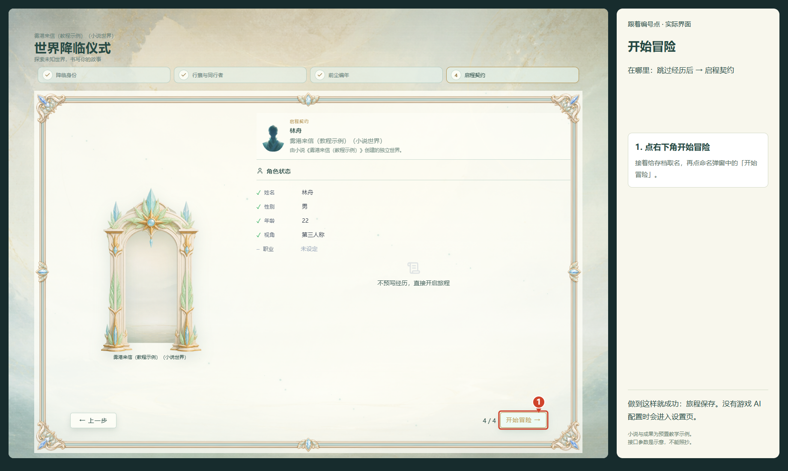

# 扮演书中人物，按原作故事开局

选择书里的人物，从原作的一段故事开始。AI 帮你整理剧情，不需要重新写小说。

## 在拆解台完成四步

1. **上传小说**：上传 TXT、EPUB，检查正文，再点「下一步：选择要拆的章节」。
2. **选章拆解**：先试拆前 10 章，也可自选起止章或整本；选择「人物设定 + 原作故事」。保存 AI 配置，再点底部「开始拆解第…章」，所选范围一起生效。
3. **人物与设定**：人物设定与原作故事在同一页查看，资料不够可继续增加章节。确认后点「用当前资料创建世界」，不必等全书拆完。
4. **创建世界**：保持原作玩法，选择已完成的故事段。底部主按钮依次执行「整理开局剧情」→「保存剧情版本并选用」→「创建世界，回大厅游玩」。默认起始阶段可以直接使用，修改剧情细节是可选操作。

所选开场未完成时，可以选择另一个已完成的段，或继续读取。剧情整理失败时，可以通过主按钮恢复上次整理。读取和整理会产生接口费用；暂停或关闭后已有成果会保留。

## 开局：在大厅打开这个小说世界

**在哪里：** 世界大厅 → 点击名字带「小说世界」的晶体

1. 没看到自己的世界，就用大厅底部箭头翻页。
2. 点世界晶体，弹出详情后点右下角「选择并继续」。

**做到这样就成功：** 进入「世界降临仪式」。

## 开局：选择你想成为的书中人物

**在哪里：** 「降临身份」→ 页面里的「主线身份与起点」

1. 在「扮演身份」下拉框选人物；在「剧情起点」选从哪一段开始。
2. 补上年龄，点选性别，再点右下角「下一步」。行囊不需要时留空，继续点「下一步」。

**做到这样就成功：** 到「前尘编年」页面。

## 开局：开始自己的这一次原作旅程

**在哪里：** 「前尘编年」→「启程契约」

1. 没想好以前的经历就点「跳过经历」。
2. 下一页点右下角「开始冒险」，给存档取名，再点弹窗里的「开始冒险」。

**做到这样就成功：** 旅程已创建。没配游戏 AI 时会跳到设置，继续下一步。

## 开局：如果跳到设置页，补好游戏 AI

**在哪里：** 设置页左侧 →「API 设置」

1. 拆小说的 AI 和游戏聊天的 AI 要分别配置。跳到这里时，刚才的旅程已经保存。
2. 填你的接口地址、密钥和模型，往下滑测试连接，再点「保存配置」。
3. 回到游戏，在输入框发送：我环顾四周，先确认自己在哪里。已经配置游戏 AI 的玩家跳过这一步。

**做到这样就成功：** 进入游戏，可以在输入框发送自己的行动。

向下滚动后的按钮位置：

截图取自实际应用界面。小说与拆解成果是教学示例，接口参数是占位示意，不能照抄。教学验证没有发起付费 AI 请求。
